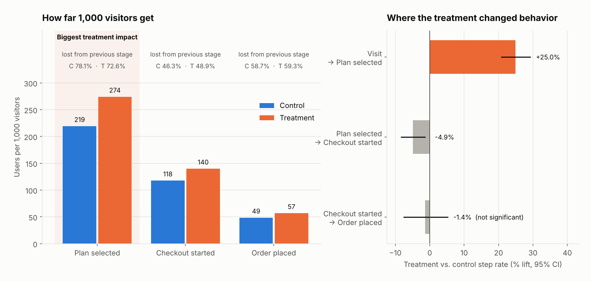

# Executive Summary: Price-per-Serving Test

**FreshCrate · Plan-selection page experiment · Sep 14 – Sep 27, 2026 · 39,228 visitors**

---

## The question

Does showing our price as **"$9.99 per serving"** instead of **"$79.92 per week"** get more visitors to place their first order?

## The answer

**Yes. The per-serving price brought in about 8 more first orders and roughly $900 more revenue for every 1,000 visitors, and we expect a smaller but still worthwhile gain once the change stops being new.**

---

## What we found

| | Current design ("per week") | New design ("per serving") | Change |
|---|---|---|---|
| Visitors who placed a first order | 4.9 in 100 | 5.7 in 100 | **+17%** |
| First-box revenue per 1,000 visitors | $4,234 | $5,139 | **+$905** |

**Could this just be luck?** Very unlikely. We split visitors between the two designs at random, so the two groups were alike in every way except the price display. If the new design truly made no difference, random chance would produce a gap in orders this large only about **1 time in 4,500**, and a gap in revenue this large only about **1 time in 58,000**. A coincidence is not a credible explanation.

**How big is the gain, realistically?** We are **95% confident the new design adds between $490 and $1,320 in first-box revenue per 1,000 visitors** (between 4 and 13 extra first orders). At our current traffic of roughly 1 million plan-page visitors a year, that is **between $0.5M and $1.3M in additional first-box revenue annually**, before counting any repeat boxes those new customers go on to order.

## Where the gain comes from

- **More visitors pick a plan.** 27 in 100 choose a plan under the new design, versus 22 in 100 today (+25%). This is where the per-serving price does its work.
- **Some of them back out at checkout.** When the weekly total appears at checkout, slightly more of these customers leave than under the current design. That "sticker shock" gives back about a quarter of the early gain, roughly 3 orders per 1,000 visitors.
- **The final payment step is unchanged.** Once customers start checkout, both designs finish at the same rate.
- **The result holds across devices and customer types.** Mobile, desktop, new and returning visitors all moved in the same direction.

---

## Recommendation: **GO** — launch the per-serving price to all visitors

The new design reliably brings in more first orders and more revenue, with no sign of harm in any customer group.

**One caveat: plan on the lower end of the range.** The new design's pull was strongest in its first week and weakened in the second, as visitors got used to it. The second-week gain (about +12% more orders, roughly $750 per 1,000 visitors) is a better guide to the long-term effect than the two-week average. Budget around **$0.5M a year**, not $1.3M, and keep tracking orders for the first month after launch to confirm the gain holds.

**Suggested next test:** show the weekly total next to the per-serving price on the plan page, to recover the customers currently lost to sticker shock at checkout.
